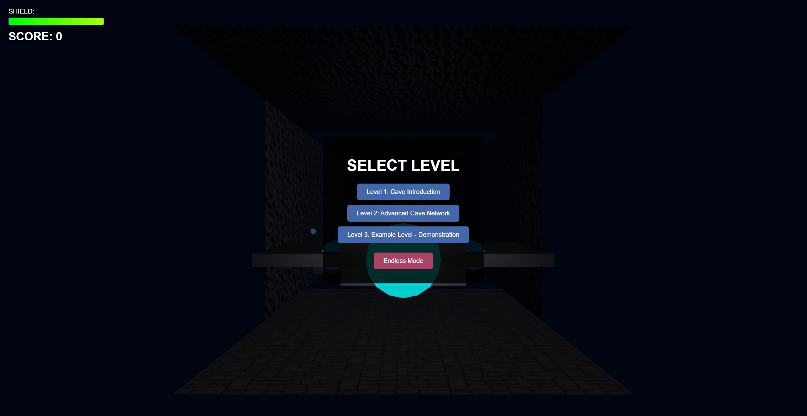

# DESCENDED - Zero Gravity Shooter

> **Project status (October 19, 2026):** **[M1](docs/M1_ACCEPTANCE.md), [M3](docs/M3_ACCEPTANCE.md) and [M4's functional workflow](docs/M4_ACCEPTANCE.md) are accepted.** The owner confirms the editor works and authored levels are playable. The latest [player experience pass](docs/PLAYER_EXPERIENCE.md) adds optional editor panels, a searchable scene browser, saved ship camera/HUD/headlight options, an original stereo score and three new authored missions. The old finite levels are retired. Hosted CI is owner-confirmed; M2 hardware frame-time acceptance remains open (last Intel GPU p95 about 18 ms against the provisional 16.7 ms target). See the [roadmap](docs/ROADMAP.md).

**Try the designer:** run `npm run dev` and open `/editor.html`, or choose **LEVEL DESIGNER** from the main menu. Click a wall/item to select it; right-click to style a face, edit an opening/door or place content at that point. Right-drag still pans; Shift+F10 or **Actions** opens the keyboard menu. Use **Playtest level** for first-person flight, then Esc and **Return to editor**. Drafts save locally and offer Restore/Discard on reload; export JSON for a portable backup. See [the UX/authoring guide](docs/progress/M4_DESIGNER_UX.md).

**Close loops and add doors:** right-click an end/wall → **Connect to existing room…**. Use **Fit corridor end to target** when a corridor stops short or penetrates the target, or **Snap separate branch** for a disconnected piece. **Full shared opening** uses the mutual clear wall area. You can attach/join separate passages on different areas of a large wall. Right-click its cyan frame → **Add or edit relay door…**, choose an existing relay or **Create relay near player spawn**, then use R nearby in Playtest. See [the loop/door guide](docs/progress/M4_LOOPS_AND_SHARED_OPENINGS.md) for format v7 and bounds.

**Move an item:** select its marker or Mission content entry, then choose **Move** or **Move selected item**. Drag the axes; white/red feedback shows whether the placement fits. Release applies one undoable move, and Esc cancels. It stays in its room and preserves heading/objective/door links. Room rotation/stretch tools are disabled until you select a room again. See [the movement guide](docs/progress/M4_CONTENT_MOVEMENT.md).

**Build vertically:** attaching a corridor to a floor or ceiling now creates a vertical shaft. The right-click menu calls this **Attach vertical shaft at this point**. Room properties include Pitch (X)/Roll (Z), and **Rotate XYZ** exposes all three quarter-turn rings. [The orientation checkpoint](docs/progress/M4_VERTICAL_CORRIDORS.md) explains format v4 compatibility.

**Resize and keep passages:** select a room/corridor and use **Stretch** to drag local X/Y/Z dimensions, or **Resize and keep connections…** to enter precise dimensions and choose a fixed opening. Numeric size edits use the same safe behavior. Attached branches move with the change; overlaps or incompatible loops are rejected. Use **Snap connections** to repair an existing misalignment. Successful resizing opts into format v6: 256 rooms, 512 connections and dimensions up to 256 units. Older imports keep their original format until an expanded edit is needed. See [the resizing guide](docs/progress/M4_CONNECTED_RESIZING.md).

**Build slopes and diagonal walls:** choose a ramp/diagonal preset and **Attach shaped corridor**, or right-click a wall → **Attach ramp or diagonal corridor…** to combine rise and sideways offset. The preview and game share real convex wall collision and end openings. Sloped sides can be styled; connections use the two rectangular ends. See [the shaped-corridor guide](docs/progress/M4_SHAPED_CORRIDORS.md) for format v5 and bounds.

Run `npm run verify` for scoped lint/type checks, unit/simulation/metrics regressions and the production build. Use `npm run lint` or `npm run typecheck` separately while editing the [checked modules](docs/progress/M3_ROOM_NAVIGATION.md). Run `npm run browser:install` once, then `npm run test:browser` for production and restart browser checks. Run `npm run smoke` for development diagnostics, or `npm run profile:arena` for three warmed hardware captures with renderer verification. See the [browser checkpoint](docs/progress/M2_BROWSER.md) and [profiling checkpoint](docs/progress/M2_PERFORMANCE.md) for coverage, commands and limits.

A 3D zero-gravity shooter in the style of Descent, built with JavaScript and Three.js. Pilot through authored connected spaces, restore relays, battle drones and extract. Build and play your own missions in the local level designer.



## Play Now

**[Play the game online here](https://aishootergame.netlify.app/)**

## Table of Contents

- [Game Overview](#game-overview)
- [Technologies Used](#technologies-used)
- [Features](#features)
- [Game Modes](#game-modes)
- [Getting Started](#getting-started)
- [Controls](#controls)
- [Code Structure](#code-structure)
- [Extending the Game](#extending-the-game)
- [Technical Details](#technical-details)
- [Future Enhancements](#future-enhancements)
- [Credits and Acknowledgments](#credits-and-acknowledgments)

## Game Overview

DESCENDED is a six-degree-of-freedom 3D shooter inspired by Descent. Navigate finite connected mines with loops, ramps, vertical hatches and relay doors. Choose first-person, external ship or immersive cockpit view.

### Game Mechanics

- **Zero Gravity Movement**: Full 6 degrees of freedom movement with your spaceship
- **Missions and practice**: Three authored campaign missions plus optional training/prototype fixtures
- **Dynamic Lighting**: Advanced lighting system that brings the cave environment to life
- **Enemy AI**: Five distinct enemy types with unique behaviors and attack patterns:
  - **Scouts**: Fast but fragile reconnaissance ships
  - **Fighters**: Balanced combat ships with moderate firepower
  - **Bombers**: Heavy ships that deploy explosives
  - **Destroyers**: Heavily armored ships with devastating weaponry
  - **Bosses**: Massive command ships with multiple attack patterns
- **Weapon System**: Multiple weapon types with unique characteristics:
  - **Pulse**: Campaign missions start with 80 rounds and include refills; the flight arena retains unlimited practice ammo
  - **Laser**: High-accuracy beam weapon
  - **Missile**: Explosive projectiles with splash damage
  - **Plasma**: Advanced energy weapon with high damage
- **Power-up System**: Collect various power-ups that enhance your ship's capabilities
- **Scoring System**: Earn points by defeating enemies and surviving longer

## Technologies Used

- **JavaScript**: Core programming language
- **Three.js**: 3D rendering engine
- **WebGL**: GPU-accelerated rendering
- **Vite**: Build tool and development server
- **Web Audio API**: Advanced audio management with spatial effects
- **Netlify**: Deployment and hosting platform

## Features

- Responsive 3D graphics with dynamic lighting
- Particle systems for explosions and environmental effects
- Spatial audio for immersive gameplay
- Multiple enemy types with unique behaviors:
  - **Scouts**: Fast, agile ships with basic attacks
  - **Fighters**: Balanced ships with moderate firepower
  - **Bombers**: Slow but powerful ships with explosive weapons
  - **Destroyers**: Heavy ships with strong armor and high damage
  - **Bosses**: End-level enemies with complex attack patterns and high health
- Various power-up types with distinct effects:
  - **Health**: Repair your shield by 25%
  - **Speed Boost**: Temporarily increase movement speed
  - **Weapon Upgrade**: Temporarily enhance weapon power
  - **Weapon Pickup**: Acquire new weapons with ammo
  - **Ammo Pickup**: Replenish ammunition for special weapons
- Level progression system with increasing difficulty
- Local level designer with portable JSON export, autosave recovery and real-runtime preview
- Collision detection and physics system
- Performance optimizations for smooth gameplay

## Game Modes

### Campaign

- **Signal Breach**: Shoot the marked entry door, use cover or the blue overhead route against a ranged fighter, and activate the uplink relay to open extraction. Explore the green loop and inspect wall seams for a hidden repair alcove. Kills are optional.
- **Vector Foundry**: Follow a rising ramp, restore lift power and climb to extraction controls.
- **Nightfall Reactor**: Clear two guards, restore coolant and shut down the reactor before upper extraction.

Signal Breach has eleven authored spaces; Vector Foundry and Nightfall Reactor have seven each. Missions include pickups, color/pattern landmarks and relay-controlled doors. Select missions individually or advance after completion. The main Start button begins Signal Breach.

### Practice and custom missions

The collapsed **Practice & prototypes** section retains Flight Training Arena, Arena Escape, Mine Link, Relay Gate and Deep Relay. The level designer creates/imports/exports the same validated documents used by the campaign. The old finite segment levels are removed; the internal endless generator remains only for existing tests/diagnostics.

## Getting Started

### Prerequisites

- Node.js **24.22.0** (pinned in `.nvmrc`; see [toolchain setup](docs/TOOLCHAIN.md))
- npm **11.21.1** (declared in `package.json`; CI installs it explicitly)

### Installation

1. Clone the repository:

   ```bash
   git clone https://github.com/yourusername/descended-game.git
   cd descended-game
   ```

2. Install dependencies:

   ```bash
   npm ci
   ```

3. Run the development server:

   ```bash
   npm run dev
   ```

4. Open your browser and navigate to `http://localhost:5173`

## Controls

- **WASD**: Forward, Left, Backward, Right
- **Space**: Move Up
- **Shift/Ctrl**: Move Down
- **Mouse**: Look around
- **Q/E**: Roll left/right
- **Arrow keys**: Local yaw/pitch (keyboard alternative to mouse look)
- **Left Click / F**: Shoot (F works without mouse capture; one shot per key press)
- **ESC**: Pause game
- **R**: Activate a visible relay within 2.5 units
- **C**: Cycle first-person → external → immersive cockpit (also available in Settings)
- **M**: Expand/close the explored-room map in any flight view; flight stays active
- **L / H**: Toggle headlights / flight instruments (also available in Settings)
- **1–4**: Select an unlocked weapon; cockpit screens show selection, ammo and locked slots
- **Reboot / Replay buttons**: Restart after death or completion; restart during play from the pause menu

## Code Structure

The project is organized into several modules for better maintainability:

```text
index.html -> main.js -> src/js/main.js  # Live game entry
src/js/
  core/             # Session, input, audio, settings, level runtime
    levels/         # Campaign JSON, finite practice fixtures and shared compiler
  entities/         # Player, enemies, projectiles, pickups
    meshBuilders/   # Five concrete enemy models
  effects/          # Managed hit/explosion visuals
  ui/               # HUD, menus and settings dialog
  utils/            # Collision, disposal, diagnostics and effect helpers
  contracts.d.ts    # Shared runtime interfaces
  combatContracts.d.ts
tests/              # Runtime, compiler and browser regressions
scripts/            # Supported lint, smoke and profiling tools
archive/            # Preserved historical sources and hash manifest
```

## Extending the Game

The game is designed to be easily extendable. Check the [DEVELOPER_GUIDE.md](DEVELOPER_GUIDE.md) for detailed instructions on:

- Adding new enemy types
- Creating new power-ups
- Implementing additional weapons
- Building custom level features
- Extending the UI

## Technical Details

### Cockpit and exploration

The industrial cockpit uses a continuous beveled dashboard, recessed weapon/navigation screens and a central round shield instrument. Diagonal canopy supports, triangular side panes, instrument hoods, textured finishes and room-palette lighting frame the view. It includes weapon silhouettes and large ammo readouts, shields/speed, a local contact scanner, an explored-room survey, modeled flight controls, panel fasteners, switches and warning lighting. The stick and thrust lever respond visually to flight; the switches are decorative. Its near-field render pass prevents walls from cutting through the cabin without changing flight physics or firing origins. H blanks the instruments and reticle while retaining the cabin; a compact mission strip remains above the windshield. See the [reviewed cockpit image](docs/progress/cockpit-canopy.png).

The automap shares the authored room/portal geometry, including rotated rooms, ramps and vertical shafts. Only entered rooms and connections between them appear. Mint marks the current room; white marks ship position/heading; amber dashed links mark closed doors between explored rooms. Discovery lasts for the current attempt and resets on replay or a new mission. It works in campaign and imported/editor missions; practice fixtures without room documents report no survey. The local contact scanner shows active enemies within 40 units relative to the ship, with height stems; it can detect contacts through walls. This first map is a fixed isometric survey, without pan/rotate/zoom or route planning.

### Renderer

The game uses Three.js/WebGL with shared wall materials, emissive markers and ship-mounted spotlights. Hardware frame-time acceptance remains open.

### Level System

- Validated, portable JSON documents shared by the editor and runtime
- Rooms, corridors, ramps, vertical shafts and loops with matching render/collision geometry
- Multiple openings per face, relay-controlled doors and mission objectives
- Sliding shot/relay doors and concealed wall panels in v8 documents; choose their controls/appearance in the editor's **Add or edit door…** dialog
- Face colors and repeating surface patterns
- Entire compact finite mission loaded together; campaign streaming is not implemented

### Physics

Custom collision detection between projectiles, enemies, and environment obstacles.

### Audio

Web Audio supplies synthesized effects and an original 40-second stereo mission score. Music/effects volumes and mute are saved; pause silences the mixer while preserving active loops. No recorded soundtrack downloads are required.

### Performance Optimization

- Reused geometry/materials and bounded effect/light ownership
- Fixed-step simulation and bounded swept movement against boxes/convex solids
- Room/portal navigation and overlap broad phase
- Runtime resource/frame diagnostics and browser regressions

## Future Enhancements

- Boss encounters
- Expanded weapon upgrade system
- Additional power-ups with unique effects
- Further editor usability: camera presets, selection isolation and multi-selection
- Campaign balance, pacing and presentation refinement
- Distinct enemy roles and encounters using vertical flanks, loops and guarded supplies; see the [enemy and encounter review](docs/ENEMY_AND_ENCOUNTER_REVIEW.md)
- Multiplayer mode
- Mobile touch controls
- VR support

## Credits and Acknowledgments

- Three.js community for the excellent 3D library
- Sound effects created with Web Audio API
- Original procedural stereo mission music
- Inspired by the classic game Descent
