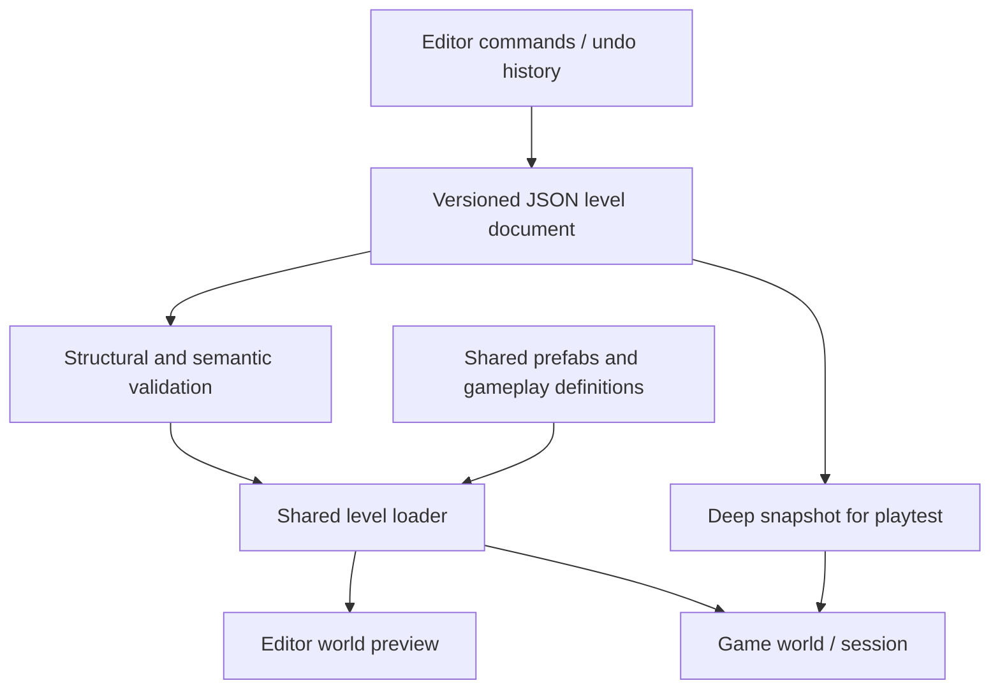

# DESCENDED: level designer proposal

Date: October 14, 2026. **Proposed design; no editor or new level loader is implemented by this audit.** Dependencies and effort are in [ROADMAP.md](ROADMAP.md).

## Product boundary

The first editor should assemble rooms/corridors and place gameplay objects. It should let someone make a small playable mission without changing JavaScript. It should not attempt the full geometry-editing power of a classic Descent mine editor in its first release.

Start with snapped box-room and corridor prefabs, compatible doorway ports, a few material/light presets, and bounded entity placement. Support vertical connections and loops. Defer freeform vertex editing, concave rooms, imported map formats, custom scripts, collaborative editing, and online publishing.

That limitation is important: the present level system cannot already represent a connected mine. A visual interface on top of the existing Z-axis list would mainly make the current tunnel generator easier to edit; it would not supply the spatial foundation the intended game needs.

## Shared runtime boundary

The editor and game should share four modules:

1. **Level document types and validation:** versioned JSON structure, IDs, limits, references, geometry/connectivity rules, and useful errors.
2. **Prefab registry:** geometry, ports, material presets, and collider generation for each supported room/corridor type.
3. **Level loader:** creates a runtime world from a validated immutable definition.
4. **Gameplay registries:** actual enemy, weapon, pickup, door, and objective definitions.

Editor selection/gizmos, viewport cameras, undo history, and unsaved-change state live outside the game. Runtime health, velocity, spawned/killed/collected IDs, projectiles, effects, and objective progress live outside the level document.



There should be one authoritative way to create a doorway, wall, collider, or enemy definition. A mismatch between editor preview and game collision is a bug, not a supported difference.

## Geometry and coordinates

Use world units with **+Y up and local -Z forward**. Player orientation is a normalized quaternion. Every room/prefab has a world transform; contained placements use room-local coordinates. Convert to world space once through the shared loader. Explicitly distinguish room dimensions, doorway opening dimensions, and entity collider size.

Each prefab exposes named ports on faces. A connection references two ports and an opening size. Matching ports must meet at the same world-space opening plane, face in opposite directions, and have adequate clearance for the player collider. The loader removes/splits the matching wall surfaces and generates colliders around the opening. An unconnected face stays solid. Doors occupy an opening and control its collision state.

Connections represent continuous traversable space, not teleportation. Keep the initial editor on a grid with right-angle rotations and rectangular openings. Allow only size/rotation combinations the shared generator and validator support. More flexible geometry can be a later version rather than an undocumented escape hatch.

The room/portal graph supports reachability checks, objective validation, navigation/map views, and coarse enemy routing. It does not replace geometric collision. Small levels can remain fully loaded; defer portal rendering or streaming until measurements justify the complexity.

## Example level document

This is a **contract sketch**, not a file the current game can load. The first implementation should formalize it in a schema and test fixtures before treating version 1 as stable. Keep data to JSON primitives, explicit IDs, and registered content types; do not serialize Three.js objects or executable callbacks.

```json
{
  "formatVersion": 1,
  "id": "core-test",
  "name": "Core Test",
  "seed": 12345,
  "rooms": [
    {
      "id": "bay",
      "prefab": "box-room",
      "position": [0, 0, 0],
      "rotation": [0, 0, 0, 1],
      "size": [20, 12, 20],
      "materialPreset": "industrial-blue"
    },
    {
      "id": "service",
      "prefab": "box-room",
      "position": [0, 0, -20],
      "rotation": [0, 0, 0, 1],
      "size": [12, 10, 20],
      "materialPreset": "industrial-blue"
    },
    {
      "id": "core",
      "prefab": "box-room",
      "position": [0, 0, -40],
      "rotation": [0, 0, 0, 1],
      "size": [20, 12, 20],
      "materialPreset": "industrial-red"
    }
  ],
  "connections": [
    {
      "id": "bay-service",
      "a": { "roomId": "bay", "port": "negativeZ" },
      "b": { "roomId": "service", "port": "positiveZ" },
      "openingSize": [6, 6]
    },
    {
      "id": "service-core",
      "a": { "roomId": "service", "port": "negativeZ" },
      "b": { "roomId": "core", "port": "positiveZ" },
      "openingSize": [6, 6]
    }
  ],
  "playerSpawn": {
    "roomId": "bay",
    "position": [0, 0, 4],
    "rotation": [0, 0, 0, 1]
  },
  "entities": [
    {
      "id": "guard-1",
      "kind": "enemy",
      "type": "scout",
      "roomId": "service",
      "position": [2, 0, 0]
    },
    {
      "id": "health-1",
      "kind": "pickup",
      "type": "health",
      "roomId": "bay",
      "position": [-3, 0, 0]
    },
    {
      "id": "switch-1",
      "kind": "device",
      "type": "switch",
      "roomId": "core",
      "position": [3, 0, 0]
    },
    {
      "id": "exit-1",
      "kind": "trigger",
      "type": "exit",
      "roomId": "bay",
      "position": [0, 0, 7],
      "size": [4, 4, 2]
    }
  ],
  "objectives": [
    {
      "id": "activate-core",
      "type": "activate",
      "targetId": "switch-1"
    },
    {
      "id": "escape",
      "type": "reach",
      "targetId": "exit-1",
      "requires": ["activate-core"],
      "completesLevel": true
    }
  ]
}
```

The rooms above share opening planes at world Z=-10 and Z=-30. Enemy/device/pickup positions are local to their room. In a real fixture, validate the player's starting orientation, trigger clearance, entity footprints, and all required routes.

Do not persist `spawned`, `destroyed`, current health, mutable Three.js vectors, timers, or cached meshes. On playtest, create a deep snapshot and a fresh session. On return, discard the runtime state and restore editor cameras/selection; the editing document must remain unchanged.

## Validation before scene creation

Structural checks should reject malformed or oversized input, unsupported versions/types, duplicate IDs, non-finite numbers, invalid quaternions, invalid dimensions, missing references, and counts beyond documented limits. Import must accept data only; no `eval`, executable level modules, arbitrary scripts, or unbounded remote asset URLs.

Semantic checks should cover:

- Exactly one valid player spawn with adequate wall clearance.
- Every required objective and exit is geometrically and graph-reachable from spawn, respecting supported door/key prerequisites.
- Connected ports align, openings fit both faces, and no port is occupied twice.
- Rooms do not overlap except at supported connections; corridors do not accidentally block an opening.
- Entity collider extents fit the room and do not start inside walls/closed doors.
- Objective references/types are valid, dependencies do not cycle, and at least one supported completion path exists.
- Pickup/enemy/material definitions exist in the same registries used by the runtime.

Use errors such as “Connection service-core: ports are 2 units apart” or “Player spawn intersects bay's ceiling,” with selection/focus actions in the editor. Reachability validation is a useful guardrail; it cannot establish that combat is fair or that a player will find the route. Manual playtesting remains an acceptance requirement.

Treat imported files transactionally: validate and construct a candidate world before replacing the current document/session. Report errors without destroying the user's unsaved work. If future format versions require migrations, migrate a copy and preserve the original export.

## Editor workflow and tools

A practical layout is a central 3D viewport, an object/room list, a prefab palette, a properties panel, and validation/playtest controls. Use familiar operations: select, move, rotate, duplicate, delete, snap, connect ports, place entities, and inspect the mission graph. Prefer a restrained interface that makes invalid placements obvious.

Three.js provides [TransformControls](https://threejs.org/docs/pages/TransformControls.html) for translation/rotation/scale gizmos. That supplies a useful interaction building block; it does not supply level semantics, doorway geometry, collision, validation, undo, or persistence. Reuse the compatible addon from the project's chosen Three.js version.

Represent edits as commands against the document: `AddRoom`, `MoveRoom`, `ConnectPorts`, `AddEntity`, `SetProperty`, and `DeleteSelection`. Keep before/after values and coalesce an entire drag into one undo item. A room deletion must include its dependent connections/entities in the same reversible operation. Gizmos manipulate document transforms; they should not silently create runtime-only edits that disappear on export.

Use browser storage for autosave/recovery and exported JSON files for portable saves. Store a document version/revision and surface the difference between a recovered draft and an exported file. No server, login, database service, or upload feature is needed for M4. Consider a separate editor entry point so players do not download its UI/gizmo code unnecessarily.

## Acceptance scenario

From a blank document, a user can place three rooms, connect them, add one enemy and pickup, place spawn/switch/exit, validate, and play to completion. They can return to editing with the document intact, move a room, undo that move, export, reload the file, and play the same mission again. Add a vertical connection and a loop as further M3/M4 fixtures.

Automated checks should cover document round trips, stable IDs, missing references, portal alignment, collider/render agreement at an opening, undo/redo, dependency deletion, session isolation, and version rejection. Manual checks should cover gizmo feel, camera/input handoff, readable errors, door traversal, and actual mission completion.

After that workflow is dependable, add more prefabs, material choices, door/key variants, map visualization, and quality-of-life tools. Freeform mine geometry is a distinct later milestone with its own mesh editing and collision budget.
