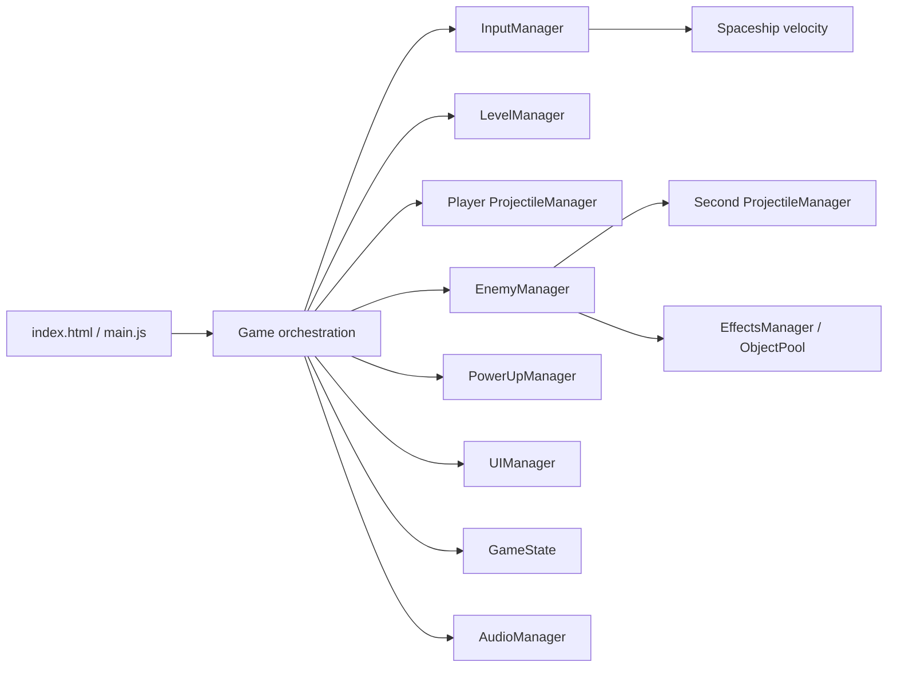

# DESCENDED: project assessment

Assessment date: **October 14, 2026** (America/New_York). Baseline: **`7e70489`**, last repository commit dated May 25, 2025. This review adds documentation and diagnostic evidence; it does not repair the game or upgrade dependencies.

**Historical baseline, not current status:** Everything below records the October 14 pre-implementation review at `7e70489`, including its then-current defects, inventory and recommendations. It is retained as audit evidence, not a current defect backlog. M1/M3/M4 are now accepted, and the game/editor have advanced substantially. Use the [current roadmap](ROADMAP.md), [handoff](progress/NEXT_SESSION.md) and [developer guide](../DEVELOPER_GUIDE.md) for implementation status, remaining work and supported extension paths. Revalidate an old finding against current source before treating it as open.

## Honest assessment

This is a recoverable browser game prototype with substantial presentation and entity work, but it is **not currently a reliably playable game**. The production bundle builds and renders a menu, HUD, ship, and tunnel. Starting either endless mode or the introductory level produces a missing audio-method error. Once started, an unrelated power-up error interrupts the simulation on every eligible frame, even with zero movement input.

Fixing those two exceptions is necessary, but insufficient. An unfinished change from moving the player to moving the world has left camera control, movement, collision, streaming, and spawn placement using incompatible coordinate assumptions. The current level system describes a sequence along one Z axis, rather than a connected mine or room network.

**Recommendation:** preserve Three.js, the working build setup, visual assets/builders, and useful gameplay definitions. Replace the player/world movement contract and session lifecycle in small, verified steps. First deliver one enjoyable, completable test mission. Introduce a shared, validated level document before building a visual editor. A wholesale engine rewrite is not justified by this code alone; continuing to add features to the current movement architecture is also unlikely to pay off.

For planning, this assumes a desktop-browser, single-player, first-person game with true six-degree-of-freedom flight and compact handcrafted levels. Commercial-quality production, multiplayer, VR, and original Descent file compatibility are outside the first target.

## What was verified

| Check | Result | Limits |
| --- | --- | --- |
| Git working tree at start | Clean; reviewed tracked source and existing guides | No historical build comparison or branch archaeology |
| Installed environment | Node `22.14.0`, npm `11.2.0`, Three.js `0.176.0`, Vite `6.3.5` | Existing installation; a clean `npm ci` was not performed |
| `npm run build` | Passes; 36 modules; main JS 624.20 kB / 155.19 kB gzip; source map 3,137.69 kB | An initial sandbox filesystem error was resolved by running the build outside the sandbox; it was not a project build defect |
| Production preview in the in-app browser | Menu, mission selection, HUD, and 3D scene render | One Chromium-based surface, not a browser/GPU compatibility matrix |
| Start endless mode | `audioManager.createSound is not a function`; repeated `powerUps is not iterable` | Continuous gameplay cannot be assessed through these blockers |
| Select Level 1 and start | Same missing audio-method failure; gameplay loop remains broken | Did not complete a mission or validate combat balance |
| Behavioral probes | All **16** baseline defects reproduced | Small direct module simulations; not an end-to-end test suite |
| `npm.cmd audit --json` | Six dependency packages rated high; all six are marked development dependencies in the lockfile | Advisory inventory, not proof of an exploitable deployed game |

Evidence: [probe output](audit/probe-results.json), [reproduction script](audit/reproduce.mjs), [browser errors](audit/browser-errors.json), and [Level 1 after Start](audit/level1-after-start.jpg). Browser log timestamps are UTC; the local audit date is October 14.

Run the probes from the repository root:

```powershell
node docs/audit/reproduce.mjs
```

They report `defect-reproduced` for the old baseline. Exit code zero means the probes executed without a harness error, **not** that the game is correct. They disable presentation/lifetime callbacks inside their own Node process and do not modify game files. After repairs, replace the relevant probes with tests that assert the intended behavior.

## Architecture and actual feature state

The live entry path is `index.html -> /main.js -> src/js/main.js`. `src/main.js` is an unused Vite starter, not the game. The root `main.js.bak`, `audio.js`, repair scripts, and debug entry points are additional historical paths, not authoritative implementations.



| System | Useful implementation already present | Actual readiness |
| --- | --- | --- |
| Rendering | Three.js scene, fog, textures, lights, ship model, dust | Renders; geometry alignment and camera ownership need correction |
| Input / flight | WASD, vertical thrust, mouse handling, inertia, speed cap | World-axis thrust; aim overwritten; roll inputs ignored; pitch restricted |
| Combat | Four player weapon configurations, ammo inventory, trails, enemy hit detection | Integration and resource issues; advanced weapon flags exceed actual behavior |
| Enemies | Five definitions and separate mesh builders, animations, pursuit and firing | Valuable prototype assets; simple steering without obstacle navigation or line of sight |
| Pickups | Five effects, meshes, collection, timed buffs | Frame-blocking typo; wrong authored type field; speed buff disconnected |
| Levels | Four JavaScript factories, obstacle patterns, custom placements, curved visuals | Linear segment list; progression, geometry, placement, and streaming are inconsistent |
| State / menus | Start, mission selection, pause, game over, score, HUD | UI exists; transitions and reset are not coherent session operations |
| Audio | Web Audio buffers, synthesized fallbacks, gain controls | Missing caller-facing method; missing requested sound files; incorrect game-over fade call |
| Persistence / editor | Ship JSON experiments, level blueprint classes | No level document import/export, schema validation, editor, undo, save system, or editor playtest loop |
| Engineering | Small dependency set, lockfile, production bundling, Netlify config | No automated assertions/runner, lint/type-check scripts, or CI workflow |

The existing README and extension guides describe intent more generously than the running implementation supports. In particular, full six-degree-of-freedom control, junctions with multiple paths, spatial audio, reliable level progression, projectile pooling, and advanced weapon effects should not be treated as accepted features.

## Findings in order of importance

Priorities here: **P0** blocks ordinary play now; **P1** prevents a reliable playable build; **P2** creates maintainability, performance, or delivery risk. Line references refer to the reviewed baseline.

### F01 / P0: Start calls an audio API that does not exist

`src/js/main.js:284` sets the started flag and hides the menu, then calls `audioManager.createSound` at line 293. Further calls occur at lines 261, 312, and 337. `AudioManager` has no such method. This was reproduced in both browser start paths and probe A01.

The player is left in a partially started state. Give sound registration one supported interface; initialize audio after user interaction; make startup succeed with sound unavailable; and only enter the playing state after required initialization succeeds. Separately, `Game.init()` catches errors without rethrowing, so the root entry can print initialization success after a failure.

### F02 / P0: Every gameplay update can stop at the power-up offset

`PowerUpManager` initializes `this.powerups` (`src/js/entities/PowerUpManager.js:202`) but `offsetPowerUps()` iterates `this.powerUps` (line 422). `Game.animate()` invokes it whenever the intended movement passes collision, including a zero vector. Its broad catch then skips streaming, projectile/enemy updates, pickup collection, spawning, and HUD updates for that frame. Browser-confirmed; probe A02.

Correct the contract and add a real start-and-advance smoke check. Do not let a repeated exception masquerade as a running game because rendering continues.

### F03 / P1: Flight and camera do not implement the advertised experience

The ship is a **child of the camera**, positioned in camera-local coordinates (`Spaceship.attachToCamera`). At `src/js/main.js:613`, the game instead treats that local ship position as a world-space follow target and overwrites the camera position and `lookAt()` every frame. Mouse yaw is consequently erased. Probe A03 produces the same final orientation after two different initial aim directions.

`Spaceship.update()` accelerates along global X/Y/Z, regardless of camera/ship attitude (A04). Q/E is passed through input, but roll is never applied (A05). Arrow-key pitch tilts the visible model, not a unified flight orientation. Mouse pitch is separately clamped.

Choose a single world-space player transform. Make the camera and cockpit views derive from it. Use a quaternion orientation for local yaw/pitch/roll and transform local thrust into world acceleration. Cosmetic camera shake must not move the gameplay collider or corrupt aim.

### F04 / P1: Moving the world conflicts with collision, streaming, and spawns

At `src/js/main.js:490`, travel moves level segments, enemies, projectiles, and pickups instead of the player. But:

- `LevelManager.updateLevel()` (`:1077`) computes progress from `camera.position.z`, which is effectively fixed by the camera-follow block. A simulated 40-unit world offset does not change the active segment index (A10).
- `offsetLevel()` (`:1157`) translates a segment **and its obstacle children**, so obstacles move twice as far in world space (A08).
- `initEndlessLevel()` (`:293`) creates 15 scene segments without populating `segmentMap`. The first streaming update creates another 15; the original groups are left outside the new tracking list (A09).
- Wall collision uses a fixed global rectangular cross section. Since the player stays near a fixed position, repeated lateral movement can move the tunnel away without the bounds tracking actual wall locations.
- Authored spawn distances use original world coordinates. Moving visible geometry does not advance the player toward those spawn definitions. Enemy bullets and effects are not consistently included in world offsets either.

Use a stationary world and move the player for the first finite mission. Disable streaming until that works. If endless mode is restored later, give it deterministic chunk coordinates and an explicit lifecycle; world-origin rebasing is a later optimization if measurements require it.

### F05 / P1: Level geometry and authoring data disagree

`LevelManager` constructs floors with `PlaneGeometry(width, height)` instead of `(width, length)` and positions side walls at `-segmentLength` instead of the midpoint. With current defaults, floor depth is 12 for a 20-unit segment; wall centers are -20 instead of -10 (A11).

`addCustomObstacles()` (`:911`) interprets definition positions as world coordinates by subtracting the segment position. Level 1's custom placements read as segment-local offsets; placing an obstacle at local Z=-10 in a segment at Z=-200 instead puts it at world Z=-10 (A12).

Every segment is still placed at `(0,0,-index*20)`. Curved mesh endpoints do not determine the next segment transform; junctions do not produce branches; non-straight segments receive closing end walls. `SegmentType.NARROW_PATH` is referenced but not defined (narrow path is an obstacle pattern). Per-definition dimensions and several documented configuration options are not consumed. The special `createEndSegment()` portal is not the route used to build `END` blueprint segments, and there is no exit-volume objective.

Repair straight geometry first. Define coordinate conventions and supported fields explicitly. Validate placements and connections before introducing additional levels. See [the editor design](LEVEL_EDITOR_DESIGN.md) for the proposed replacement authoring model.

### F06 / P1: Combat contracts and special weapon behavior are incomplete

`EnemyManager` constructs `new ProjectileManager(scene, audioManager)` at line 22, but the constructor signature is `(scene, camera, audioManager)`. The second manager receives an audio manager in its camera field and no audio dependency (A07). Some enemy-projectile operations happen to receive a camera separately, masking the problem.

Enemy firing's `inFrontOf` condition (`EnemyManager.js:527`) tests a negative dot product against the **player's** forward direction, tending to allow firing behind the player rather than ahead. Enemies steer directly toward the camera and do not navigate obstacles or check walls for visibility. No projectile-versus-level collision path is present.

Player explosive and penetrating flags are stored, but enemy-hit handling always removes the projectile and applies only direct-hit damage. Splash damage is not implemented there; `explosionRadius` is not retained by `createProjectile()`. Guided player missiles steer toward `this.camera`, effectively targeting the player. `ProjectileTypes.js` is not imported by the active firing implementation, so its richer behavior definitions are not authoritative.

Use one explicit projectile ownership contract, with a faction/owner, damage, lifetime, collider, and optional target. Start with one reliable pulse weapon and direct damage. Add line-of-sight tests, swept projectile collision against level/enemies, then implement each advertised special property with an observable acceptance test.

### F07 / P1: Completion, reset, pause, and pickup state lack one owner

- `EnemyManager.checkLevelCompletion()` (`:278`) has no completion latch. It is reached from updates and kills, and spawning is also called from both manager and game. It can repeatedly call `GameState.levelCompleted()`, awarding bonuses and scheduling multiple next-level timers (A14).
- Completion is based on predefined enemy kills, not reaching an exit. Next-level loading updates `LevelManager.currentLevelIndex`, but not `Game.currentLevelIndex`; later restart can select an old level.
- `resetLevel()` removes enemies via `destroyEnemy()`. That path records predefined kills, updates UI/completion, and produces explosions while supposedly cleaning up. It can repopulate destroyed-spawn tracking during reset. Removal needs a reason distinct from a combat kill.
- `restartGame()` / `restartLevel()` (`src/js/main.js:654` and `:678`) retain velocity, projectiles, boosts, kill statistics, and potentially pause state (A16); endless restart does not reset enemies. Pickups and timers are not consistently cleared between sessions.
- `spawnPredefinedPowerUps()` reads `spawnPoint.type`; `LevelBlueprint` writes `powerupType` (A13). It mutates the reusable blueprint's `spawned` field, which is not reset on reload. `speedMultiplier` is never read by the active movement code; the endless pickup interval is checked but never initialized.
- Wall-clock `setTimeout` and independent pickup animation loops continue during pause and can affect a later session. Pointer-lock loss does not itself pause simulation or clear held keys; shooting has no paused-state check. Returning from mission selection creates a new start screen without wiring the start callback supplied by `Game.init()`.
- `GameState.gameOver()` calls `sounds.engine.fadeOut()` (`:236`) on a sound record. Fade-out belongs to a playing-source handle returned by `playSound()`, so death can throw before releasing pointer lock.

Introduce a session state machine (`menu`, `loading`, `playing`, `paused`, `dead`, `completed`, `error`), a simulation clock, and one `startSession(levelId)` / `endSession(reason)` path. Keep level definitions immutable; track spawned/collected/killed IDs in the session. Make completion idempotent. All session callbacks must be cancelled or invalidated on exit.

### F08 / P1: Simulation speed depends on frame rate

Ship damping multiplies velocity by 0.96 per rendered frame. After one idle second starting at speed 6, the probes give **0.518 at 60 Hz versus 0.0447 at 120 Hz** (A06). Enemy translation (`EnemyManager.js:419`), steering smoothing, and several animations are also applied per frame. Conversely, the main delta clamp discards elapsed simulation time when frames exceed 33.3 ms while timers still use real time.

Use a bounded fixed-step accumulator for gameplay, or consistently time-scaled motion with suitable substeps. Use exponential time-scaled damping. Express movement, attack cooldowns, buffs, and lifetime in seconds on the simulation clock. Compare equivalent simulations at 30/60/120 Hz; do not equate a successful render loop with consistent gameplay.

### F09 / P2: Resource ownership and performance need measurement

`clearLevel()` and streaming unload remove scene groups without releasing their owned GPU resources or consistently pruning obstacle references. Projectiles share cached geometry, but individual projectile removal disposes that geometry while another projectile still uses it (A15). Three.js can recreate disposed GPU data, so this is a resource ownership/re-upload risk, not a guaranteed immediate invisible-projectile bug.

`destroyEnemy()` discards the animation function returned by `createExplosionEffect()`. Those particles are added to the scene without the cleanup animation being advanced. `EffectsManager.processExplosionEffects()` returns when the explosion-mesh queue is empty, before processing its light queue; non-explosive lights can be stranded. Both effect systems need one lifecycle.

Object pooling is implemented for some effects, **not** the active projectile creation path. New projectile/enemy/pickup point lights can increase rendering cost. A documented atmospheric probability optimization is reversed: `if (Math.random() > 0.95) return` generates particles about 95% of the time, not 5%. Debug helpers patch global `THREE.Object3D` methods in production and retain scene/camera references.

Fix ownership first, then profile a reproducible combat scene. Track frame-time percentiles, draw calls, active lights, triangles, entity counts, and renderer geometry/texture counts across repeated restarts. No reliable performance claim can be made from the current broken loop. The bundle-size warning is a secondary concern relative to simulation correctness.

### F10 / P2: Tooling, dependency baseline, and documentation are behind the code

The package only exposes `dev`, `build`, and `preview`. `EnemyManagerTest.js` logs and spawns objects; it is not an assertion suite. `src/js/test.js` is a comment. `.github` contains a Copilot instructions placeholder, not CI. There is no pinned Node policy, lint/type check, schema validation, or replayable gameplay fixture.

The advisory check reports these six packages, all marked `dev: true` in the lockfile:

| Package | Locked version | npm audit severity |
| --- | --- | --- |
| vite | 6.3.5 | High |
| rollup | 4.40.2 | High |
| postcss | 8.5.3 | High |
| nanoid | 3.3.11 | High |
| picomatch | 4.0.2 | High |
| source-map-js | 1.2.1 | High |

This is a development/build toolchain maintenance issue, not evidence of six vulnerabilities in the shipped game runtime. A maintainer-published [Vite Windows advisory](https://github.com/vitejs/vite/security/advisories/GHSA-fx2h-pf6j-xcff) includes the installed Vite range; its described impact depends on network exposure and filesystem conditions. Patch the toolchain early in an isolated change and re-audit. Do not blindly apply a forced major upgrade alongside gameplay repairs.

For modernization, choose a currently supported Node LTS baseline using the [Node release schedule](https://nodejs.org/en/about/previous-releases). Current [Vite setup documentation](https://vite.dev/guide/) requires Node 20.19+ or 22.12+; the README's Node 14+ guidance is stale. A major Vite update also needs its [migration guide](https://vite.dev/guide/migration), rather than assuming a version-number bump is the whole job.

`TunnelGeometryManager`, `ObstacleFactory`, and `LightingManager` are not integrated into the live level path; the first includes an unfinished curve method. The JSON ship files have no active loader. Repair scripts and backups should be archived or removed deliberately after a baseline is captured. Record asset origins and credits before public release. Update the old guides against supported behavior rather than continuing their speculative examples.

## What to keep, replace, and postpone

| Keep and adapt | Replace or consolidate | Postpone |
| --- | --- | --- |
| Three.js / static browser deployment | Camera/player/world transform ownership | Multiplayer, matchmaking, accounts |
| Enemy mesh builders and visual direction | Session reset, pause, completion, timers | VR, mobile controls, WebGPU migration |
| HUD concepts, weapon/ammo definitions | Linear tunnel authoring as the long-term level format | Full arbitrary-geometry mine editor |
| Synthesized audio fallback functions | Duplicate projectile/effect responsibilities | Descent level-file import/export |
| Small modular classes where ownership is clear | Unused refactor stubs and production monkey patches | User-generated-content hosting/gallery |
| Existing level ideas as reference content | Unvalidated mutable blueprint/runtime data mixture | More enemy types before basic combat works |

A heavy ECS, backend service, UI-framework rewrite, or physics engine is not a prerequisite for the next milestone. Add a physics library only if the agreed geometry/collision requirements and a short prototype justify it.

## Decision and next deliverable

The viable path is a **focused rebuild of the gameplay foundation within this repository**, with reusable presentation code retained. The next deliverable should be one test mission with true flight, solid walls, one weapon, two enemy behaviors, a pickup, an explicit objective/exit, and correct pause/death/restart. It must be playable from menu to completion without a console exception.

The [roadmap](ROADMAP.md) gives sequencing, acceptance gates, effort ranges, and the first work items. The [level editor design](LEVEL_EDITOR_DESIGN.md) explains how to get an editor without maintaining a second game engine.
