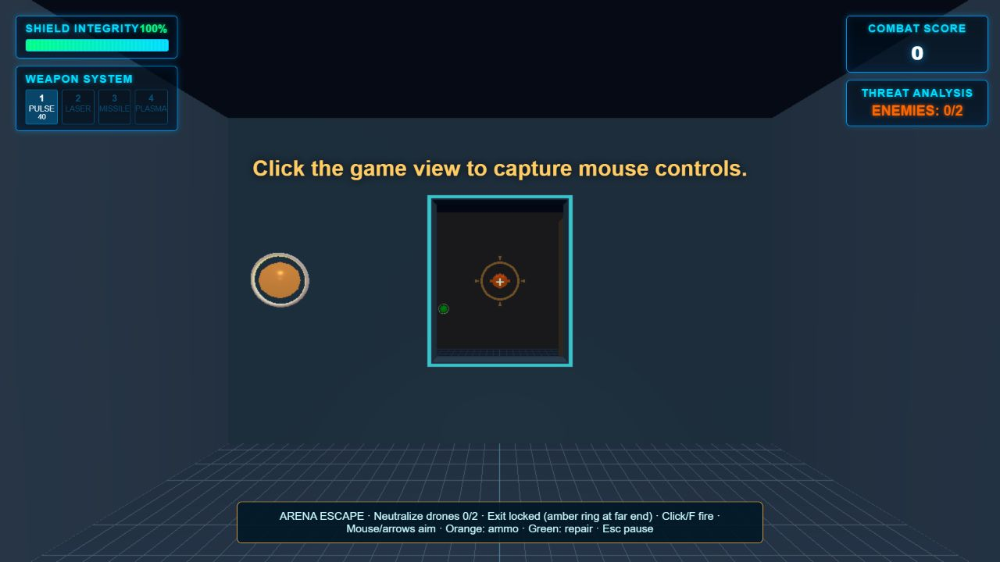
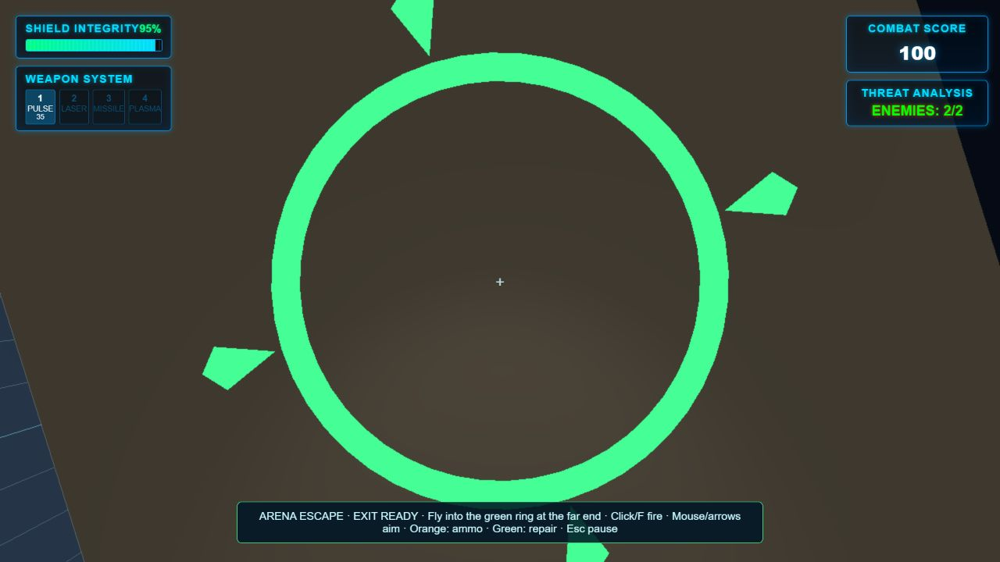

# M1 objective and extraction checkpoint

> Follow-up (October 15, 2026): **[M1 is accepted and complete](../M1_ACCEPTANCE.md)** following the owner's Chrome playthrough. The implementation/checklist below records this earlier mission checkpoint; M2 stabilization continues.

Implemented October 15, 2026, following the [wall-aware combat checkpoint](M1_COMBAT.md). The combat fixture is now **Arena Escape**, a small playable graybox mission. This establishes the mission loop; it does not establish a finished campaign or complete the remaining manual acceptance checks.

## Play the mission

Run `npm run dev`, open the local URL, then choose **Select Level > Arena Escape**. **Start Flight Arena** still opens quiet flight practice. The older missions remain legacy content.

Use W/S forward/back, A/D strafe, Space/Shift vertical thrust, Q/E roll, mouse or arrows to aim, and **left click or F** to fire. F fires once per key press and works without mouse capture. Escape pauses; the pause menu can restart. A click that acquires mouse capture still does not fire a shot.

Neutralize the fighter and scout, then fly into the exit ring at the far end of the second chamber. The ring and objective guide change from amber/locked to green/ready. Clearing the last drone alone does not complete the mission. A center reticle helps aim.

## Rules and state ownership

- The immutable internal level definition supplies required enemy IDs, exit, combat settings and pickup IDs. `MissionObjective` holds a fresh session's progress and completion latch; no progress is written into level definitions.
- The two required drones remain `combat:fighter` and `combat:scout`. Shots award the existing kill points/statistics: fighter 100, scout 50. Ramming can neutralize a drone, damages the player, and gives no kill points/statistics. Ordinary entity removal and session teardown give no objective progress. Fatal ramming cannot advance the mission after death.
- The exit is centered at `(0,0,-24)` with radius 1.5. Completion requires both drones neutralized and the radius-0.5 player sphere fully inside the exit sphere. The visual ring is a marker with no solid collider. Exit checks occur after combat and pickups in the fixed simulation step; lethal enemy fire takes precedence over extraction in that step.
- Completion grants 1,000 points once and freezes the session. Both shot kills yield 1,150 total. Direct completion requests cannot bypass an unfinished objective. Replay, Reboot, mission selection and pause/restart all use the existing session teardown/start path.
- Pulse damage remains 5. This mission starts with 40 rounds and caps reserve at 80. The orange pickup at `(-3,0,1)` adds up to 20 rounds; the green pickup at `(-4,-2,-20)` repairs up to 25 health. Full health/ammo does not consume the corresponding pickup. Collection requires proximity and a clear sight line through structural geometry.
- Authored pickups persist until collected and appear once per session. Restart restores both pickups, both drones, locked exit, health, inventory, score and statistics. Quiet practice and legacy pulse retain unlimited ammo. The mission still excludes unfinished special weapons and random weapon drops.
- Enemy destruction shares the ordinary removal/disposal path, followed by an explicit combat-defeat event. Cleanup cannot accidentally award a kill or unlock an exit.

## Verification

**89 tests pass.** The combat test file now has 25 checks, including 11 added objective/mission checks. Coverage includes required IDs and duplicate events, locked-exit rejection, full-body exit clearance, single completion/bonus, ramming versus kills versus cleanup, finite ammo and capacity, pickup collection/occlusion/persistence/reset, F-key repeat/capture/phase behavior, pause at the exit, lethal fire at extraction, and ten full completion/restart cycles. Existing startup, flight, wall, projectile, session and buff tests continue to pass.

`npm run build` passes. The existing bundle warning remains at about 644 kB minified / 162 kB gzip. `git diff --check` passes. Dependency upgrades and CI are outside this checkpoint.

A production preview was exercised through ordinary keyboard and menu controls, with no development diagnostics or injected runtime state:

1. Select Arena Escape. Five F presses destroyed the fighter; ammo decreased from 40 to 35 and score reached 100.
2. Fly through the doorway. The pursuing scout collided with the ship: health reached 95, score stayed 100, and the exit became ready.
3. Fly into the green ring. **Mission Complete** showed 1,100, including the single completion bonus.
4. Replay restored health 100, ammo 40, score 0, two live drones and locked exit.
5. Allow enemy fire to reach **System Failure**, then choose Reboot. Initial state was restored again; Escape paused the new session.

No game console errors were recorded. The browser run proves a shot-kill plus ramming route; automated trace tests cover both shot kills and the 1,150-point result. Browser pickup collection was not independently exercised; it is covered by manager/simulation tests.

Evidence: [browser states and error log](mission-browser-check.json), [completion screen](mission-result.jpg), [failure screen](mission-loss.jpg).

## Remaining acceptance and next work

The embedded browser refused pointer lock, so this run used the supported keyboard fire/aim controls. Captured mouse aiming/firing, turn-and-return flight while inverted, handling/readability tuning and measured frame/resource budgets still need hands-on acceptance in a regular browser. No mouse-capture or performance success is claimed here.

This mission reuses two chambers and basic visibility/pursuit AI. Enemies still have no room routing or search behavior. Exit checks sample the player's position each 60 Hz step; they are adequate at the current bounded speed, rather than a general continuous trigger solver. Ammo and combat timing are provisional; wasting every round may require restarting. Legacy level geometry remains unrepaired. The internal mission object is not a validated user-import format.

The next engineering checkpoint is **M2's dependency/runtime baseline and CI**: verify a clean install, document supported Node/npm, assess and patch dependency findings, and automate the existing regression suite and production build. Follow with browser smoke automation and measured resource/flight acceptance. Then M3 can establish validated shared JSON rooms/ports/objectives before editor UI work.
