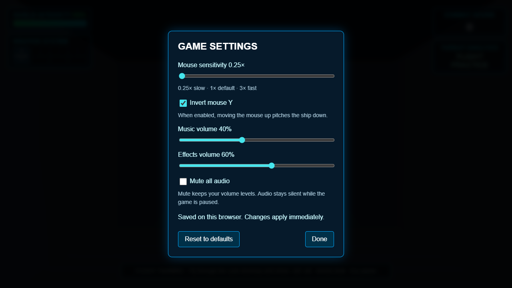

# M2 saved audio settings checkpoint

> Follow-up: [player/input contracts](M2_PLAYER_CONTRACTS.md) expand checking to eleven runtime modules, with 114 runtime tests and 35 negative compiler examples. The implementation and counts below record this earlier checkpoint.

Implemented October 15, 2026, following the [initial lint/type contracts](M2_CONTRACTS.md).

## Delivered and how to use it

Open **Settings** on the main menu or pause screen. The panel now reads **GAME SETTINGS** and includes the existing sensitivity/invert-Y controls plus:

- **Music volume:** 0–100%, in 1% increments. Default 40% preserves the previous music mixer level.
- **Effects volume:** 0–100%, in 1% increments. Default 60% preserves the previous effects mixer level, including engine and combat sounds.
- **Mute all audio:** silences both groups while retaining their volume values. Default is off.

Changes apply immediately and save automatically. **Reset to defaults** resets all five preferences. Done or Escape closes settings; closing a paused panel leaves the game paused. Unmuting while paused stays silent until Continue. Changing settings on the main menu does not create an audio context or start playback.

Preferences survive mission restart, return to the menu and page reload. Existing control-only records retain their mouse settings and acquire the original audio defaults. The settings panel remains keyboard accessible and scrolls within a small viewport.

The [390x640 keyboard-focused view](audio-settings-small-viewport.png) records the small viewport check.

## State and audio ownership

`UserSettings` still owns immutable snapshots outside mission state. Its optional callback applies each loaded/updated/reset snapshot to the game's audio manager. It has one owner for the lifetime of the game, with no per-session event subscriptions or callbacks to accumulate. The preference declaration now describes all five fields as `UserPreferences`.

Audio remains lazy: saved values reach `AudioManager` before its first initialization. Group gains keep music and effects separate, preserving existing per-sound volume and synthesized-effect attenuation. Nonfinite/incorrect volume inputs are rejected; supported numeric inputs are clamped. Saved volumes are additionally rounded to 1% steps. Storage denial or write failure still applies live changes and reports the persistence limit in the panel.

Mute and pause independently silence the master gain. Pre-initialization mute now retains its state. Muted playback passes through the silent mixer, so a mission started muted still establishes its music/engine loops. Unmuting changes the mixer without replacing those sources or restarting their position. Restart stops the old sources and creates one new music/engine pair. Session teardown preserves user preferences.

The existing local key `descended.settings.v1` and numeric version 1 remain compatible: audio fields are additive with defaults, rather than a destructive migration. Loading an old record does not rewrite it. An explicit update saves only the supported fields. Unsupported future versions still fall back to defaults without rewriting storage. This remains local browser/site storage, not account settings or a mission save.

## Verification and limits

`npm run verify` passes under Node **24.22.0** / npm **11.21.1**, and under the existing Node **22.14.0** / npm **11.2.0**. This includes scoped lint, strict type checking with **17 negative consumer examples**, **112 unit/simulation/metrics tests**, and the production build. The output is approximately **658.02 kB** minified / **166.41 kB** gzip, with the existing chunk-size warning.

Six new unit/integration tests cover additive loading and round-trip, invalid/clamped/rounded audio fields, live updates/reset with failed storage, muted startup/pause/resume/restart, loaded preferences applied to actual playing-source groups, and pre-init/failed-init/retry behavior with safe volume setters. Existing mouse-control and unsupported-audio startup regressions remain in the suite.

All **six browser checks pass in one complete run**, with zero page/console/asset-request errors; see [the audio browser report](audio-settings-browser-check.json). The suite includes the existing production victory/loss/replay flow, ten-restart resource fixture, mouse/settings focus and layout checks, and blocked saving, plus two new cases for saved mixer behavior and missing Web Audio support. Ten measured restarts return resources to baseline after warm-up. The mixer case observes native AudioContext gain/source creation at the browser boundary; it does not inject game state or expose a production debug API. Desktop and small viewport screenshots were visually checked.

Browser automation verifies mixer values and source ownership, not the sound heard from physical speakers/headphones. A hardware listening check remains useful for comfortable balance and abrupt-change artifacts. The browser renderer is software based; this checkpoint establishes no new GPU timing or native mouse acceptance result. Hosted CI awaits a push. Dependencies and lockfile are unchanged, so the last [dependency audit](contracts-dependency-audit.json) remains the recorded snapshot; it was not rerun for these source changes.

## Next work

Saved mouse and audio preferences now cover the planned M2 settings baseline. Next, expand checked interfaces into player/input and projectile/enemy ownership, and remove unused code only after confirming references. M3 still needs a validated shared level document/loader and a connected-room mission before the designer UI.

M1 is now [accepted and complete](../M1_ACCEPTANCE.md) following the owner's Chrome playthrough. Hosted CI and M2 performance acceptance remain open. The last measured Intel GPU frame p95 remains around 18 ms against the provisional 16.7 ms target. M2 is not complete.
