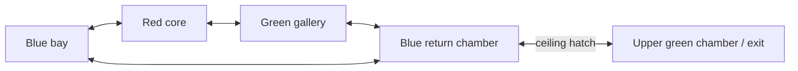

# Shared level data and connected-world prototype checkpoint

Implemented October 15, 2026, following [enemy orchestration/source cleanup](M2_ENEMY_ORCHESTRATION.md). [M1 remains accepted](../M1_ACCEPTANCE.md). This delivers the shared data boundary and an initial M3 geometry prototype; M2 and M3 are not complete.

## Playable result

Choose **Select Level → Mine Link Prototype**. The bundled [JSON document](../../src/js/core/levels/documents/mine-link.v1.json) defines five rooms, a horizontal loop and a floor/ceiling hatch to an upper chamber. It places two drones, health, pulse ammo and an exit. Start with 60 rounds; clear both drones and enter the green ring upstairs. **Space** ascends and **Shift/Ctrl** descends. The guide identifies the upper chamber rather than referring to the old arena's far end.

Flight Arena, Arena Escape and the legacy level indices remain available. The two accepted M1 arena documents and their tuning were not converted or replaced. The new prototype is a separate menu entry.

## Shared format and runtime path

[The format specification](../LEVEL_DOCUMENT_FORMAT.md), `src/js/levelDocument.d.ts` and the executable validator establish **formatVersion 1**. Rooms/corridors, transforms, six named face ports, connections, placements, combat rules and the existing clear-and-exit objective use JSON primitives. No Three.js objects, current health, spawned/killed flags, callbacks or remote asset paths belong in exported data.

Validation checks structure, unknown fields, supported content/version, numeric/count/work limits, normalized player rotation, globally unique IDs, references, room/placement overlap, wall/body clearance, connected-port alignment/fit/occupancy and reachability from spawn. It produces bounded `{path, code, message}` diagnostics. It builds an owned frozen snapshot without changing the caller's editing document; import/export preserves authored ordering and emits deterministic JSON.

The compiler rotates/translates room-local placements and composes the player's quaternion with room yaw. Each connected face splits into four wall pieces around its opening; unconnected faces stay closed. The same world-space solids create visible boxes and swept-collision boundaries through the existing finite-world builder. The whole small world remains loaded. The sample produces **60 wall solids/colliders**.

Player radius and the two supported pickup model definitions are shared with actual runtime creation. Authoring enemy clearance derives from actual enemy definitions and is checked against every generated enemy envelope. Exit placement also reserves its decorative marker's margin; pointers scale with the trigger radius.

`Game.startLevelDocument(unknownData)` stages a validated definition and detached world before ending a current run. Invalid input or candidate construction errors preserve that run and catalog. Successful imports reuse one catalog slot and use normal start/restart/reset behavior. Partial world/marker construction is cleaned up; after ownership transfers, mount errors use normal error-session recovery and release resources once. That later recovery does not restore the previous run. There is no file-import UI yet; this API is the handoff for a future editor.

## Verification

Scoped lint and strict JSDoc checking cover **32 runtime modules**, up from 25. The seven additions are shared content metadata, room transform math, structural/semantic validators, document compilation, the JSON-backed prototype factory and the shared arena/world builder. Main game/level/UI glue remains outside the full static-check scope and is covered here by integration tests. Sixteen new negative compiler examples bring the total to **96**.

The runtime suite contains **197 cases**, including 50 new document cases: malformed/future/oversized/non-JSON input, IDs/references/overlap/port errors, unknown content, immutable round trips, shared model clearance, transformed placements, exact mesh/collider agreement, door/hatch shots and sphere traversal in both directions, full session completion/replay, ten document restarts, imported-slot reuse and failure ownership before/during mounting. The runtime navigation test uses actual input, inertia and swept collision through the loop and hatch; it neutralizes drones through normal manager damage/objective handling to isolate traversal.

The pinned **Node 24.22.0 / npm 11.21.1** verification passes lint, strict checking, all 197 runtime cases and the production build. Lint/type checks and all 197 runtime cases also pass on the existing **Node 22.14.0 / npm 11.2.0**. All **eight Chromium checks pass in one final complete run**, with zero page, console or asset-request errors; see [browser evidence](level-documents-browser-check.json). The browser suite adds production selection/reset for the JSON mission and development keyboard navigation through its loop/hatch, completion and replay. Development navigation uses read-only diagnostic position/time/speed and the labeled neutralize control; it does not inject player transforms. The accepted M1 combat production flow remains separately tested using keyboard fire and real enemy damage.

The report includes ten mine waypoints, including up/down/up through the hatch and a completed exit, plus seven mixer samples. The separate Arena Escape restart test still returns all eleven samples (warm-up plus ten measured cycles) to 41 geometries, 72 scene objects, 34 materials and nine lights, with no active effect lights or cached effects. This is the accepted arena's resource baseline, not a new mine GPU benchmark. Screenshots show [the production mine start](mine-start.png) and [development completion](mine-complete.png).

The first browser route overshot a turn because its coarse polling held thrust too long. The corrected route estimates velocity from diagnostic simulation timestamps, brakes through keyboard input and settles drift before changing axes. This is test steering; accepted flight physics is unchanged.

Dependencies and lockfile are unchanged. The existing [dependency audit](contracts-dependency-audit.json) remains historical evidence. Production output is approximately **679.41 kB** minified / **173.76 kB** gzip, with the existing chunk-size warning. Software rendering is not hardware frame-time acceptance. Hosted CI still requires a push.

## Limits and next work

This is a constrained, executable format rather than the earlier proposal's general objective sketch. Room yaw is limited to quarter-turns; prefabs are empty rectangular shells. There are no authored obstacles, doors, switches, keys, chained objectives, freeform mine geometry, ship importers or editor UI. Existing enemy visibility/local pursuit is reused; graph routing for enemies remains unimplemented. Enemy spawning/removal still uses the legacy 5–50-unit proximity window, so distant undefeated enemies can be recreated with default health when revisited. The canonical fixture fits that window; persistent room-aware activation is needed before a larger mine. Validation does not prove combat fairness or an adequate ammo budget. Legacy executable levels are not automatically migrated.

The next M3 work is persistent enemy activation/room-aware routing and a small objective/door interaction, followed by a more deliberately authored mission and human playtesting. Keep the format/editor boundary shared; add a format migration if incompatible semantics are needed. M4 should start from this loader with placement, validation, undo and JSON import/export, rather than implementing a second geometry system.

M2's hosted CI and hardware performance acceptance remain open, along with broader unchecked presentation/orchestration code. The last Intel GPU p95 remains around 18 ms against the provisional 16.7 ms target. This prototype has not established a new hardware baseline or completed M3 acceptance.
