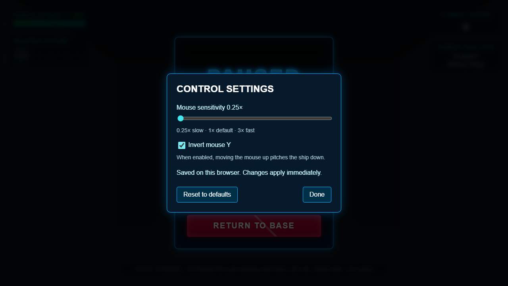

# M2 saved control settings checkpoint

> Later status update (October 15, 2026): **[M1 is accepted and complete](../M1_ACCEPTANCE.md)** following the owner's Chrome playthrough. M1-pending statements below describe this earlier checkpoint.

Implemented October 15, 2026, following the [hardware profiling checkpoint](M2_PERFORMANCE.md).

## Delivered and how to use it

Choose **Settings** on the main menu or pause with Escape and choose **Settings**. Changes apply immediately and save automatically on the current browser/site. Done returns focus to the Settings button. Escape closes the dialog and leaves a paused game paused; Continue resumes flight separately.

- **Mouse sensitivity:** 0.25x to 3x, in 0.05 increments. The default 1x preserves the existing 0.002 radians per mouse pixel, and the multiplier applies to mouse yaw and pitch.
- **Invert mouse Y:** moving the mouse up pitches down when enabled. Default is off. Arrow-key pitch/yaw retain their existing behavior and rates.
- **Reset to defaults:** restores and saves sensitivity 1x and inversion off. Preferences are independent of mission progress, inventory and session reset.

The modal supports keyboard controls, explicit Tab/Shift-Tab boundaries, focus restoration, and small viewports. Background controls are inert while it is open. Gameplay keys cannot fire, move or resume the session from within the panel. Main and pause menu content can scroll when the window is short.

## Storage and input contract

`UserSettings` holds immutable current values outside `GameState`. `InputManager` reads them on mouse movement, so there is no stale sensitivity copy or subscription to clean up. The existing active-play and pointer-lock guards still apply. Opening settings is restricted to menu/paused phases and clears held keys; teardown closes the dialog.

Preferences use `localStorage` key `descended.settings.v1`, with a numeric version and the two known preference fields. Loading validates types, bounds and step size. Malformed, missing or unsupported-version records fall back to defaults without silently rewriting the stored record. Explicit updates/reset save the current supported format. Unknown fields are ignored.

Unavailable storage, denied access, read errors and quota/write failures do not prevent startup or live preference changes. If saving fails, the panel reports that changes could not be saved; current values continue in memory. A later successful write recovers. These preferences are local to a browser and site origin: development and preview on different ports have separate records. They are not a cloud account setting or a saved mission.

## Verification

**106 unit/simulation/metrics tests pass** on the pinned Node 24.22.0/npm 11.21.1 toolchain. Eight new settings checks cover default compatibility, versioned round-trip, malformed/future records, clamping/step/type validation, storage denial/read/write failures, reset and recovery, real player-root sensitivity/inversion, capture/phase guards, keyboard behavior and modal input isolation.

**Four browser checks passed:** the existing production victory/replay/death/reboot/menu flow and ten-restart resource fixture, plus two production settings checks. The settings checks verify saving across reloads and restarts, reset, Escape preserving pause, focus return/wrapping, 390x640 layout, and a deliberately blocked storage-write boundary. The existing regressions passed in the suite run; the settings checks passed in focused reruns after accessibility/focus fixes. No game page, console or asset-request errors were recorded. Hosted Windows/Linux CI execution remains pending a push.

The production build passes with the existing bundle warning (about 655 kB minified / 166 kB gzip). `git diff --check` passes. No dependencies changed. Evidence: [browser results and restart samples](settings-browser-check.json), [desktop view](settings-desktop.png), [small viewport](settings-small-viewport.png).

These checks verify preference behavior and UI wiring; they do not replace physical mouse/flight-feel assessment. Mouse motion was exercised against the real controller in simulation tests with a capture fixture. This checkpoint does not claim a new native captured-mouse browser acceptance result or a new performance measurement.

## Remaining milestones

M1's [hands-on acceptance](../M1_ACCEPTANCE.md) remains open for native mouse capture, inverted return flight, handling and readability. Use these controls to tune sensitivity before that run, and record any adjustments still needed.

M2 now has saved mouse controls, browser regression coverage and a measured hardware baseline. The provisional frame-time target remains unmet, and hosted CI, volume/mute, focused lint/type contracts and broader cleanup remain. Next engineering work should establish those source contracts incrementally, then M3's validated shared level documents and connected-room prototype can prepare the designer.
