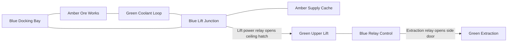

# M3 authored mission: Deep Relay

Implemented October 16, 2026, after the [relay prototype](M3_RELAY_OBJECTIVE.md) and [CI reliability repairs](M2_CI_RELIABILITY.md). The owner has pushed the reliability checkpoint and started a fresh GitHub run; its result is still pending. M1 remains accepted. This checkpoint supplies the larger M3 mission, not final M3 acceptance.

## Playable content

Choose **Select Level → Deep Relay**. It is appended at catalog index 8; the accepted arenas and both JSON prototypes keep their indices. Its canonical source is [deep-relay.v2.json](../../src/js/core/levels/documents/deep-relay.v2.json), loaded through the existing validator, compiler, collision, AI and objective paths. No new schema version, executable mission script, dependency or editor-specific format is introduced.

Eight spaces include a four-room lower loop, a narrow rotated side cache, a taller upper lift/control deck and a final extraction chamber. All eight connections have six-unit openings. Surface colors and height/width changes supply basic landmarks; these remain primitive shells rather than finished environment art.

Spawn is behind a solid part of the north wall, outside direct enemy sight. Three fighters and two scouts are required. The five drones have 95 total health: nineteen successful five-damage pulse hits, compared with seventy starting shots and two twenty-round caches (capacity 100). Two repairs restore twenty-five shield points each. The side cache is optional; neither supply pickup is a progression key. These numbers establish headroom, not a claim that combat balance is finished.

The lift relay in the lower junction opens the ceiling hatch. The extraction relay in upper control opens the final side door. Each must be activated with **R** within 2.5 units and clear sight. Both relays and all five defeats are mandatory. Extraction awards the existing 1,000-point bonus once; shooting all drones gives a 1,400 final score. Ramming can produce a lower combat score.

## Navigation and shared format

[MineGuide.js](../../src/js/core/levels/document/MineGuide.js) reads the validated room/portal graph. The HUD identifies the current room, its surface color, the next reachable inactive relay and the first passage toward it. Ceiling and floor hatches are named explicitly. Once relays are active, guidance points toward extraction; the separate combat counter still explains whether it is locked. Closed connections are excluded, and reachable relay selection follows breadth-first room distance rather than JSON array order. Hints update when moving, unlocking or restarting. The same helper works for both earlier JSON prototypes.

Room display names are generated from descriptive stable IDs; amber matches the existing `industrial-red` preset's actual appearance. No text enters the DOM as HTML. Hints identify adjacent destinations but do not add a compass, automap, objective scripting or file-import UI. Those can be judged after playtesting rather than expanding this checkpoint.

## Verification and limits

Pinned Node 24.22.0 / npm 11.21.1 passes scoped lint, strict checking, **260 runtime tests** and production build. Scope is now **38 runtime modules / 108 negative compiler examples**. Six new tests cover immutable format round trips and supply budget, quiet starting cover, graph guidance and relay-order independence, real thrust/collision through all connections in both directions, two-stage completion and ten restarts, and ordinary pulse/projectile damage against all five authored encounters.

Traversal tests neutralize enemies first to isolate flight and progression. The combat test positions the player at fixed encounter locations and aims regular pulse shots while simulation/AI advance; it asserts shot defeats, survival and at least forty remaining rounds without ammo pickups. It does not replace a human combat playthrough. Restart tests check stable scene ownership, closed gates, empty objective state, five restored enemies, 98 solid colliders, starting shield/ammo and unchanged authoring data.

All **eleven browser checks pass** in one complete local Windows run under **fourfold Chromium CPU throttling**, with zero recorded browser errors and no retries. The run took 10.3 minutes; the larger mission traversal took 3.8 minutes. Existing production combat, both prototypes, pause/restart resource ownership and settings/audio cases remain green. [The evidence](deep-relay-browser-check.json) preserves timings, environment, traversal observations and twelve restart resource samples. Functional viewport is 960x540 with ANGLE SwiftShader.

The two added cases exercise production selection/restart and development keyboard traversal through the lower loop, cache, chained gates, exit and replay. The development traversal uses the explicitly labeled neutralization control, read-only flight diagnostics and real keyboard thrust; it never injects player transforms. Build: `/assets/index-DiRlekEi.js`, 699.27 kB / 178.92 kB gzip, 63 build modules. The existing bundle-size warning remains.

Both saved screenshots were visually inspected: [production spawn](deep-relay-start.png) and [development upper lift](deep-relay-upper-lift.png). The production HUD is readable. At 540px height the development-only diagnostics partly overlap the guide footer; tidy that tooling layout in a follow-up. The software-rendered frame timings shown there do not measure the hardware gate.

No hardware benchmark or dependency audit was repeated for this content-only change. The Intel GPU p95 gate remains open, as does hosted Ubuntu/Windows confirmation. Software-rendered browser timings are functional evidence, not hardware performance acceptance.

## Next acceptance step

Use the [Deep Relay playtest checklist](../DEEP_RELAY_PLAYTEST.md) to judge navigation, combat fairness and pacing. Record trouble spots and tune this mission before calling M3 complete. M4 should then build a minimal room/connection/entity editor using the existing validated document, with playtest/export/reload as its first end-to-end workflow.
